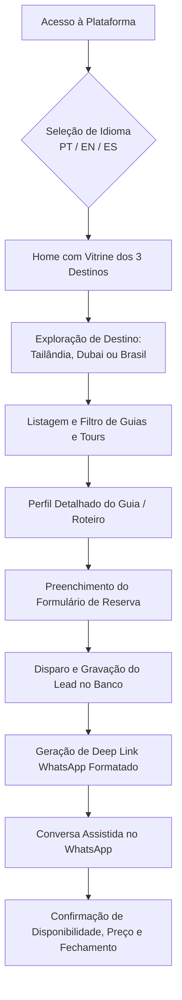
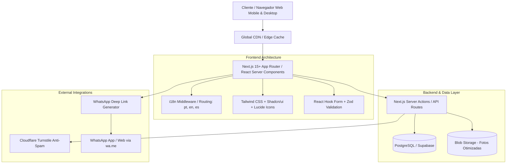
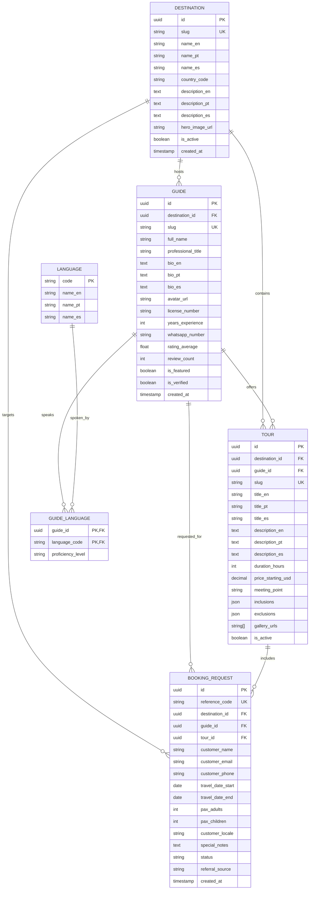
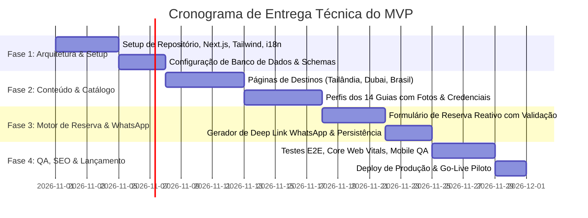

# Documento de Engenharia de Software e Especificação Técnica (SRS)
## Plataforma Internacional de Turismo — Piloto MVP (Tailândia, Dubai/EAU e Brasil)

**Versão:** 1.0.0-MVP  
**Status:** Pronto para Revisão Técnica  
**Autor:** Engenharia de Software & Arquitetura de Soluções  
**Data:** 27 de Outubro de 2026  

---

## 1. Visão Geral e Escopo do Produto

### 1.1 Objetivo do Negócio
Criar uma plataforma digital internacional moderna, confiável e multilíngue que conecta viajantes a guias turísticos locais certificados e altamente qualificados em 3 destinos estratégicos: **Tailândia**, **Dubai/Emirados Árabes Unidos** e **Brasil**, operando inicialmente com uma rede piloto de **14 guias selecionados** (6 na Tailândia, 5 em Dubai/EAU e 3 no Brasil).

### 1.2 Estratégia de MVP (Minimum Viable Product)
No modelo de lançamento (Fase 1 - MVP Piloto), o processo transacional funcionará via **Lead Generation & Assisted Booking Concierge**:
1. O viajante pesquisa destinos, guias e experiências na plataforma web.
2. Configura sua solicitação de reserva (datas, número de pessoas, guia preferido ou roteiro desejado).
3. O sistema registra a solicitação no banco de dados e gera uma ponte direta e contextualizada com a equipe de atendimento/guia via **WhatsApp**.
4. Detalhes finais, personalização de itinerário e pagamento são concluídos via canal assistido, mitigando custos e complexidades regulatórias imediatas de pagamentos cross-border e split internacional de pagamentos.

---

## 2. Personas e Jornada do Usuário

### 2.1 Personas Principais
- **Viajante Internacional (Traveler):** Busca segurança, autenticidade, guias que falem seu idioma e facilidade de agendamento rápido sem fricção burocrática. Utiliza predominantemente smartphone durante o planejamento e viagem.
- **Guia Local Credenciado (Local Guide):** Profissional verificado com registro local que deseja visibilidade qualificada para clientes internacionais de alto padrão, recebendo leads prontos com itinerário pré-definido.
- **Operador Concierge / Administrador (Platform Admin):** Gerencia a curadoria dos perfis dos guias, monitora solicitações de reserva e direciona leads.

### 2.2 Diagrama de Fluxo da Jornada (Customer Journey)



---

## 3. Requisitos de Engenharia de Software

### 3.1 Requisitos Funcionais (RF) — MoSCoW

| ID | Módulo | Descrição do Requisito | Prioridade |
| :--- | :--- | :--- | :--- |
| **RF-01** | **Homepage** | Apresentação visual imersiva dos 3 destinos com hero banners de alta resolução, proposta de valor, contadores dinâmicos de guias disponíveis e acesso rápido aos destinos. | **Must Have** |
| **RF-02** | **Destinos** | Páginas individuais de cada destino (`/destinations/thailand`, `/destinations/dubai`, `/destinations/brazil`) contendo contextualização cultural, principais atrações, dicas e listagem dos guias locais vinculados. | **Must Have** |
| **RF-03** | **Perfis de Guias** | Página individual para cada um dos 14 guias com: foto profissional, bio, selo de verificação/credencial, idiomas fluentes, especialidades, anos de experiência, tabela/lista de serviços e depoimentos. | **Must Have** |
| **RF-04** | **Catálogo de Experiências** | Detalhamento de passeios e roteiros (duração, inclusões, itinerário sugerido, fotos e estimativa de preço ou "preço sob consulta"). | **Must Have** |
| **RF-05** | **Motor de Solicitação de Reserva** | Formulário de reserva reativo com: seleção de destino, seleção de guia/experiência, datas da viagem, quantidade de adultos/crianças, idioma preferido de atendimento e campo de observações especiais. | **Must Have** |
| **RF-06** | **Integração WhatsApp** | Mecanismo de deep-link dinâmico (`wa.me`) que formata uma mensagem padronizada contendo código de referência da solicitação, nome do cliente, destino, datas e guia escolhido. | **Must Have** |
| **RF-07** | **Internacionalização (i18n)** | Suporte completo a pelo menos 3 idiomas: Inglês (`en`), Português (`pt`) e Espanhol (`es`), com persistência de preferência e URLs amigáveis para SEO (`/en/...`, `/pt/...`). | **Must Have** |
| **RF-08** | **Registro & Auditoria de Leads** | Gravação de todas as solicitações de reserva em banco de dados antes do redirecionamento ao WhatsApp, permitindo mensuração de funil e taxa de conversão. | **Must Have** |
| **RF-09** | **Filtros e Busca de Guias** | Filtro de guias por destino, idioma falado e tipo de passeio (cultural, gastronômico, aventura, luxo). | **Should Have** |
| **RF-10** | **Anti-Spam & Rate Limiting** | Proteção contra envios automatizados no formulário de reserva via Cloudflare Turnstile / reCAPTCHA invisível e limite de requisições por IP. | **Should Have** |
| **RF-11** | **Backoffice Administrativo** | Painel simples para criação/edição dos dados dos guias, destinos e exportação de leads. | **Should Have** |
| **RF-12** | **Multi-Moeda Indicativa** | Conversor de moeda visual (USD, EUR, BRL, AED, THB) para visualização de valores médios estimados. | **Could Have** |
| **RF-13** | **Avaliações com Verificação** | Sistema de feedback pós-atendimento para coleta de reviews pontuados. | **Could Have** |
| **RF-14** | **Checkout Online Direto** | Processamento direto de pagamentos (Stripe Connect). | *Won't Have (Fase 2)* |

---

### 3.2 Requisitos Não-Funcionais (RNF)

1. **RNF-01 — Performance & Core Web Vitals:**
   - **LCP (Largest Contentful Paint):** $\le 2.0\text{s}$ mesmo em redes móveis 4G.
   - **CLS (Cumulative Layout Shift):** $< 0.05$.
   - **FID / INP:** $< 100\text{ms}$.
   - Otimização automática de imagens com conversão para WebP/AVIF e carregamento sob demanda (*lazy loading*).

2. **RNF-02 — Mobile-First & Responsividade:**
   - Como mais de 85% das interações com WhatsApp originam-se em dispositivos móveis, toda a navegação e formulários devem ser desenhados sob a filosofia mobile-first (elementos de toque com área mínima de $48\times48\text{px}$, drawer menus e bottom-sheets para formulários).

3. **RNF-03 — Internacionalização & SEO Internacional:**
   - Arquitetura de rotas baseada em subcaminhos de localidade (`/pt`, `/en`, `/es`).
   - Implementação de tags `<link rel="alternate" hreflang="..." />` em todas as páginas para evitar canibalização de SEO e garantir indexação por país.
   - Metadados semânticos OpenGraph e Twitter Cards traduzidos dinamicamente.
   - Microdados estruturados (`Schema.org/TouristAttraction`, `Schema.org/Person`, `Schema.org/TouristTrip`).

4. **RNF-04 — Segurança e Privacidade de Dados (LGPD & GDPR):**
   - Transmissão 100% criptografada via HTTPS (TLS 1.3).
   - Sanitização estrita de entradas em formulários contra Cross-Site Scripting (XSS) e SQL Injection.
   - Política de Privacidade clara e banner de consentimento de cookies conforme GDPR e LGPD.
   - Telefones e dados sensíveis dos guias e clientes tratados com anonimização opcional.

5. **RNF-05 — Disponibilidade e Escalabilidade Global:**
   - Hospedagem em arquitetura Edge/Serverless com CDN global distribuída (ex.: Vercel Edge Network ou Cloudflare), garantindo baixa latência para usuários conectando-se da Ásia (Tailândia), Oriente Médio (Dubai), Europa e Américas (Brasil).

---

## 4. Arquitetura de Software e Stack Tecnológica Recomendada



### 4.1 Tecnologias Selecionadas e Justificativa

| Camada | Tecnologia | Justificativa Técnica |
| :--- | :--- | :--- |
| **Framework Fullstack** | **Next.js (App Router, TypeScript)** | Suporte nativo a Server Components (RSC) para SEO veloz, roteamento dinâmico i18n, Server Actions seguras e `next/image` para compressão e entrega otimizada de imagens turísticas. |
| **Estilização & UI** | **Tailwind CSS + Shadcn/ui** | Design system modular, design limpo e responsivo, sem overhead em tempo de execução e fácil customização temática. |
| **Validação de Dados** | **Zod + React Hook Form** | Tipagem estrita de ponta a ponta (TypeScript), validação síncrona/assíncrona no cliente e servidor sem duplicar regras. |
| **Banco de Dados** | **PostgreSQL (via Supabase ou Prisma ORM)** | Estrutura relacional sólida para relacionar Destinos, Guias, Experiências, Idiomas e Solicitações de Reserva. |
| **Internacionalização** | **next-intl** | Solução madura para Next.js App Router com suporte a namespaces de tradução, formatação de datas/moedas regionais e SEO hreflang automático. |
| **Armazenamento de Mídia** | **Cloudflare R2 ou Supabase Storage** | CDN global de baixo custo para armazenamento e distribuição de imagens em alta definição dos guias e pontos turísticos. |

---

## 5. Modelo de Dados Relacional (ERD)



---

## 6. Especificação da Integração com WhatsApp

A integração com o WhatsApp é o elemento crítico de conversão do MVP. Para evitar perdas de leads e garantir uma experiência sem fricção, adota-se a seguinte estratégia:

### 6.1 Geração do Deep Link & Template Padronizado
Antes do redirecionamento, a solicitação é salva no banco via **Server Action**, gerando um código de referência unívoco (ex.: `#FOR-2026-9481`).

#### Estrutura do Link:
`https://wa.me/{PHONE_NUMBER}?text={ENCODED_MESSAGE}`

#### Modelo da Mensagem Formatada (Exemplo em Português):
```text
Olá, equipe ForTurismo! 👋
Gostaria de consultar a disponibilidade para a seguinte viagem:

📋 *Referência:* #FOR-2026-9481
🌍 *Destino:* Dubai, EAU
👤 *Guia Escolhido:* Ahmed Al-Mansoor (ou "Qualquer guia disponível")
📅 *Período:* 15/11/2026 a 20/11/2026
👥 *Viajantes:* 2 Adultos, 1 Criança
🗣️ *Idioma de Preferência:* Português
📝 *Interesses:* Passeio histórico pelo Old Dubai e Safari no deserto.

Nome: Lucas Silveira
Aguardo informações de valores e disponibilidade. Obrigado!
```

### 6.2 Política de Roteamento Telefônico (Decisão Arquitetural)
- **Modo Concierge Centralizado (Recomendado para o MVP):** Todas as mensagens são direcionadas para o número oficial da plataforma/agência. A equipe de atendimento valida a disponibilidade com o guia correspondente da rede (Tailândia, Dubai ou Brasil) e mantém o controle sobre a negociação e qualidade do atendimento.
- **Modo Direto ao Guia:** Apenas nos casos em que a operação definir que o guia é autônomo e responsável direto pela sua própria agenda, utilizando o campo `guide.whatsapp_number`.

---

## 7. Estrutura de URLs e Roteamento Multilíngue (i18n)

Para garantir máxima indexação nos motores de busca (Google Brasil, Google US, Google UAE/Tailândia), adota-se prefixo de rota:

| Rota Canônica | Finalidade |
| :--- | :--- |
| `/[locale]` | Página Inicial (Hero, Destinos, Apresentação, Como Funciona, Guias em Destaque) |
| `/[locale]/destinations` | Catálogo Geral dos Destinos |
| `/[locale]/destinations/[destination_slug]` | Hub do Destino (Ex.: `/thailand`, `/dubai`, `/brazil`) com roteiros e guias locais |
| `/[locale]/guides` | Diretório Internacional de Guias com filtros |
| `/[locale]/guides/[guide_slug]` | Perfil individual e detalhado do guia |
| `/[locale]/tours/[tour_slug]` | Detalhe de uma experiência ou roteiro específico |
| `/[locale]/booking` | Formulário Geral de Solicitação de Reserva |
| `/[locale]/about` | Sobre a Plataforma, Garantia de Verificação e Contato |

*Locales suportados no lançamento:* `pt` (padrão Brasil), `en` (padrão internacional), `es` (América Latina e Espanha).

---

## 8. Critérios de Aceite e Cenários de Teste (BDD / Gherkin)

### Cenário 1: Navegação e Reserva de Guia em Dubai
```gherkin
Funcionalidade: Solicitação de orçamento com guia específico
  Dado que um usuário de língua inglesa acessa "/en/destinations/dubai"
  Quando ele seleciona o perfil do guia "Ahmed Al-Mansoor"
  E clica no botão "Request Booking / Check Availability"
  E preenche o formulário com 2 adultos, datas entre 10/12/2026 e 15/12/2026 e seu nome
  E envia o formulário
  Então o sistema deve persistir a solicitação com o status "PENDING"
  E deve abrir a janela do WhatsApp com a mensagem pré-formatada contendo o código de referência e detalhes da viagem
```

### Cenário 2: Alternância de Idioma Preservando a Página
```gherkin
Funcionalidade: Troca de idioma contextual
  Dado que o usuário está visualizando o perfil de um guia na Tailândia em "/pt/guides/somchai-prasert"
  Quando ele clica no seletor de idioma e escolhe "English"
  Então o sistema deve redirecioná-lo para "/en/guides/somchai-prasert"
  E todo o conteúdo estático e dinâmico da página deve ser renderizado em inglês
```

---

## 9. Plano de Implementação e Etapas do Piloto MVP



---

## 10. Checklist de Decisões Prévias com o Cliente / Stakeholder

Antes de iniciar a codificação, solicitamos confirmação para as seguintes diretrizes:
1. **Canal WhatsApp:** As solicitações via WhatsApp devem cair em um número de **atendimento central (Concierge ForTurismo)** ou diretamente no WhatsApp de cada um dos 14 guias?
2. **Moeda Padrão de Exibição:** Prefere preços cotados em Dólar Americano (**USD**), ou com conversão automática aproximada para BRL, EUR, AED e THB?
3. **Imagens e Biografias dos 14 Guias:** O material fotográfico e certificações já estão catalogados para inserção no banco de dados / assets?
