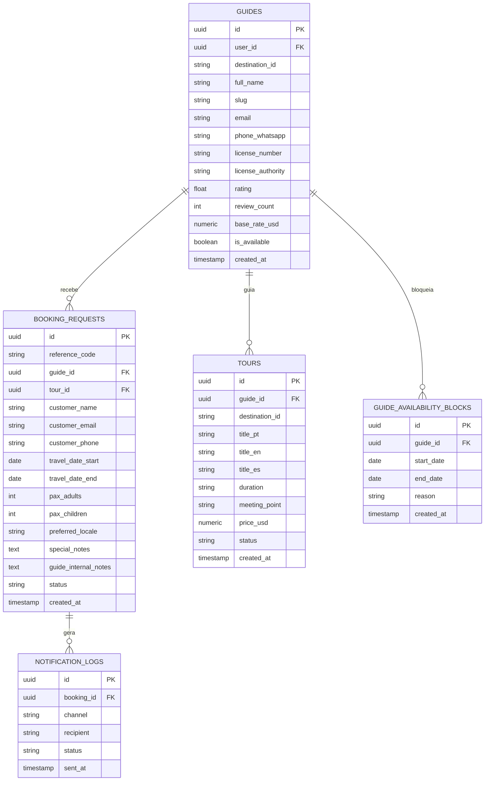
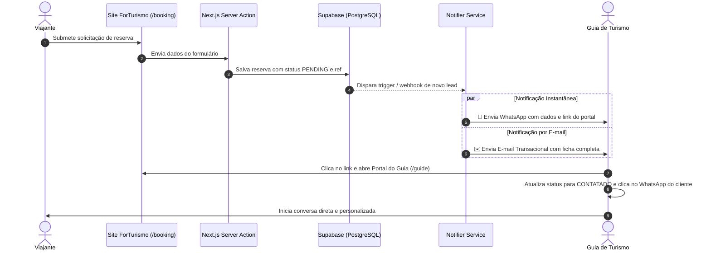

# Documento de Especificação de Requisitos e Arquitetura (SRS)
## Módulo: Portal do Guia de Turismo (Guide Partner Portal)

**Versão:** 1.0.0  
**Data:** 28 de Outubro de 2026  
**Status:** Aprovado via Entrevista Técnica de Arquitetura  
**Escopo:** Plataforma Internacional ForTurismo (Tailândia, Dubai/EAU e Brasil)  

---

## 1. Visão Geral e Propósito

O **Portal do Guia** é a área restrita e operacional da ForTurismo desenvolvida especificamente para os **guias de turismo locais credenciados** (iniciando com o piloto de 14 guias em Bangkok, Chiang Mai, Phuket, Dubai, Abu Dhabi e Rio de Janeiro).

### 1.1 Objetivos de Negócio
1. **Autonomia Operacional:** Permitir que o guia credenciado controle sua própria disponibilidade, consulte itinerários e bloqueie datas de folga/viagens sem atrito burocrático.
2. **Atendimento Ágil aos Viajantes:** Notificar o guia instantaneamente quando um novo viajante solicitar reserva para o seu destino/roteiro, reduzindo o tempo de primeiro contato (SLA < 15 minutos).
3. **Qualidade e Curadoria ForTurismo:** Manter um equilíbrio em que o guia propõe novos passeios e experiências exclusivas, mas a ForTurismo revisa os padrões de luxo, conformidade e tabela de preços antes da publicação na vitrine global.

---

## 2. Decisões Estratégicas Alinhadas na Entrevista

| Dimensão | Decisão Definida | Justificativa Técnica & Negócio |
| :--- | :--- | :--- |
| **Autenticação** | **Código OTP ou Link Mágico via WhatsApp** | Guias de campo vivem em constante movimento (em trânsito ou no roteiro). Não guardam senhas complexas. A validação direta pelo número oficial de WhatsApp cadastrado na ForTurismo garante segurança instantânea com zero fricção. |
| **Banco de Dados & Backend** | **Supabase (PostgreSQL + RLS + Auth)** | Banco relacional robusto com *Row Level Security* (RLS) nativo (um guia nunca tem acesso aos dados de outro guia), autenticação moderna, API GraphQL/REST instantânea e suporte a eventos em tempo real (*Realtime Subscriptions*). |
| **Notificações de Leads** | **Híbrido (WhatsApp API + E-mail Transacional)** | Disparo imediato via WhatsApp oficial do guia para alerta sonoro urgente no smartphone, complementado com e-mail transacional (Resend/SendGrid) com a ficha completa e espelho do lead para arquivamento e calendário. |
| **Nível de Autonomia** | **Autonomia Moderada (Curadoria)** | O guia possui total liberdade para pausar agenda e bloquear datas de forma imediata no calendário. Alterações de preço e cadastro de novos tours entram em esteira de moderação da ForTurismo para garantir o padrão *quiet luxury* da marca. |

---

## 3. Requisitos Funcionais (RF-PG)

### 3.1 Módulo de Acesso e Perfil
* **RF-PG-01 (Autenticação sem Senha via WhatsApp):**
  * O guia informa seu número de WhatsApp oficial cadastrado ou seleciona seu perfil oficial na lista credenciada.
  * O sistema dispara um código OTP de 6 dígitos numéricos (válido por 10 minutos) via WhatsApp.
  * Ao validar, uma sessão segura é emitida com JWT e persistida via cookies HTTPOnly seguros.
* **RF-PG-02 (Snapshot e Credencial Oficial):**
  * O painel exibe a credencial governamental oficial ativa (ex.: TAT na Tailândia, DTCM em Dubai, CADASTUR no Brasil), foto com selo de verificação e os idiomas atendidos.

### 3.2 Módulo de Disponibilidade e Calendário
* **RF-PG-03 (Chave Operacional Master):**
  * Toggle imediato no topo da tela: `🟢 Disponível para Novas Reservas` vs. `🟡 Em Viagem / Agenda Pausada`.
  * Quando pausado, o perfil público do guia exibe aviso sutil e impede novas solicitações diretas naquele período.
* **RF-PG-04 (Bloqueio Granular de Datas):**
  * O guia pode selecionar períodos no calendário (Data Inicial, Data Final e Motivo opcional, como "Tour privativo externo", "Férias") para bloquear datas específicas.
  * O motor de reservas público consulta a tabela de bloqueios antes de permitir que o viajante escolha datas conflitantes.

### 3.3 Módulo de Reservas, Leads e Atendimento
* **RF-PG-05 (Painel de Leads Exclusivos):**
  * Listagem filtrável por status (`PENDENTE`, `CONTATADO`, `CONFIRMADO`, `CANCELADO`) de todas as solicitações em que o guia foi expressamente escolhido ou alocado.
  * Detalhamento com: Nome do cliente, telefone internacional, datas da viagem, quantidade de passageiros (adultos/crianças), preferências culturais e código de protocolo unívoco (`#FOR-2026-XXXX`).
* **RF-PG-06 (Disparador WhatsApp Direto ao Viajante):**
  * Botão de 1 clique que abre o WhatsApp diretamente com o cliente (`wa.me/<telefone>`), injetando uma mensagem predefinida elegante no idioma de preferência do viajante (PT, EN ou ES).
* **RF-PG-07 (Bloco de Anotações Privadas do Guia):**
  * Campo de notas internas visível unicamente pelo guia (ex.: "Cliente tem mobilidade reduzida", "Aniversário de casamento no dia 20").

### 3.4 Módulo de Roteiros e Catálogo
* **RF-PG-08 (Gestão de Roteiros do Guia):**
  * Visualização de todos os roteiros publicados em que o guia atua.
* **RF-PG-09 (Submissão de Novos Roteiros para Curadoria):**
  * Formulário onde o guia propõe uma nova experiência (Título, descrição, duração, ponto de encontro, inclusões, idioma e preço sugerido em USD).
  * O roteiro fica com status `PENDING_REVIEW` até aprovação da ForTurismo no painel administrativo `/admin`.

---

## 4. Requisitos Não-Funcionais (RNF-PG)

1. **RNF-PG-01 (Segurança & Row Level Security - RLS):**
   * Nenhum dado de reserva, lead ou anotação de um guia pode ser lido ou alterado por outro guia. A política RLS do PostgreSQL no Supabase valida estritamente:
     ```sql
     CREATE POLICY "Guias só visualizam suas próprias reservas"
     ON booking_requests FOR ALL
     USING (auth.uid() = guide_id);
     ```
2. **RNF-PG-02 (Mobile-First de Extrema Usabilidade):**
   * O layout deve operar com perfeição em telas de 360px a 430px (smartphones iOS e Android comuns entre guias em campo), com botões táteis mínimos de 48px e navegação por abas inferiores (*bottom tabs* ou drawer suave).
3. **RNF-PG-03 (Performance & Offline Resilience):**
   * Carregamento do painel em menos de 800ms em redes 4G/3G de destinos internacionais.
   * Cache otimizado de dados do guia para acesso mesmo em conexões instáveis.

---

## 5. Arquitetura de Dados no Supabase (Schema PostgreSQL)



---

## 6. Fluxo de Notificações Híbridas em Tempo Real



---

## 7. Próximos Passos de Implementação Técnica
1. Configuração do cliente Supabase (`@supabase/ssr` e `@supabase/supabase-js`) com as variáveis de ambiente necessárias.
2. Execução da migration DDL das tabelas no Supabase.
3. Criação do serviço de Notificações (`src/lib/notifications.ts`) para envio do WhatsApp e E-mail.
4. Conexão do formulário `/guide` às Server Actions conectadas ao Supabase.
